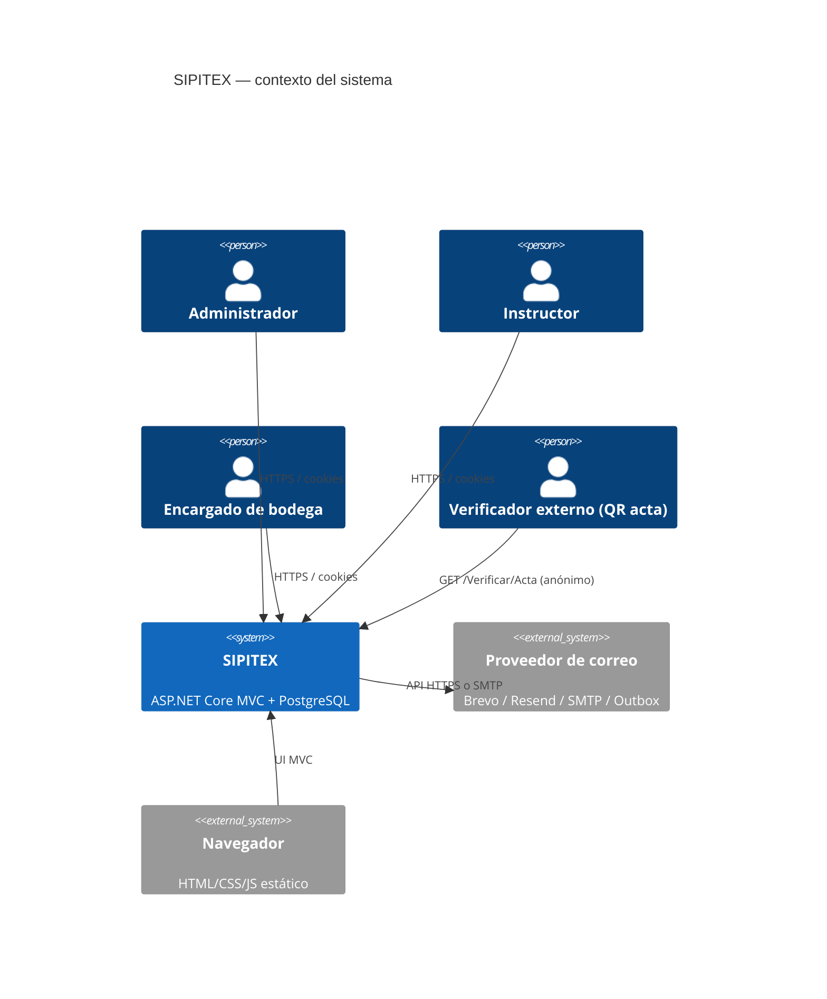
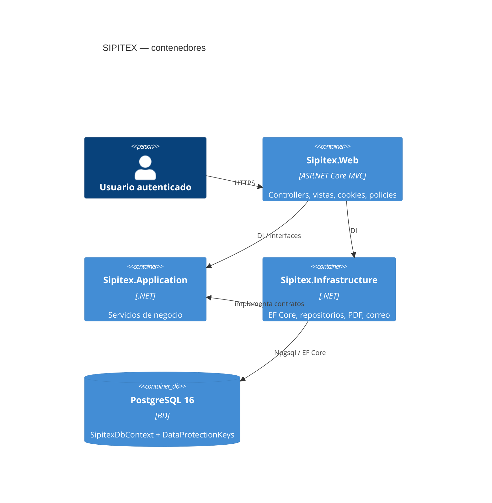
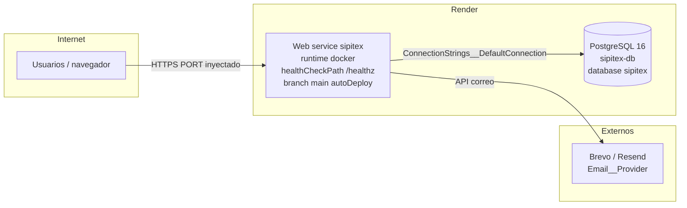
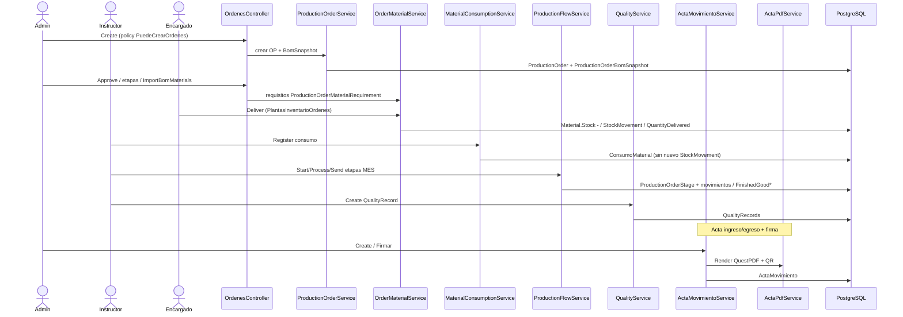

# Diagramas técnicos SIPITEX

Diagramas Mermaid derivados de `README`, `Program.cs`, `render.yaml`, `docker-compose.yml` y servicios de flujo. Sin inventar nodos no presentes en el código.

## C4 — Contexto

## C4 — Contenedores

## Despliegue — Render (web + PostgreSQL)

Fuente: `render.yaml`, `docs/DEPLOY.md`, `Dockerfile`.

Compose local (`docker-compose.yml`): servicio `db` (`postgres:16`, volumen `sipitex-pgdata`) + `sipitex` (`8080:8080`, healthcheck `/healthz`).

## Secuencia — flujo completo OP → entrega → consumo → MES → calidad → PT → acta

