# Modelo de datos — entidades principales

**Fuente:** `src/Sipitex.Domain/Entities/*`, `SipitexDbContext`. Campos resumidos; ver entidades para detalle completo.

## ER (Mermaid)

```mermaid
erDiagram
  User ||--o{ UserPlantaInventario : asigna
  PlantaInventario ||--o{ UserPlantaInventario : tiene
  PlantaInventario ||--o{ Material : contiene
  Material ||--o{ BomItem : usa
  BomProduct ||--o{ BomItem : define
  BomProduct ||--o{ ProductionOrder : "ProductName"
  ProductionOrder ||--o{ ProductionOrderBomSnapshot : congela
  ProductionOrder ||--o{ ProductionOrderMaterialRequirement : requiere
  Material ||--o{ ProductionOrderMaterialRequirement : material
  ProductionOrder ||--o{ ProductionOrderStage : etapas
  ProductionOrder ||--o{ ConsumoMaterial : registra
  Material ||--o{ ConsumoMaterial : consumido
  ProductionOrderMaterialRequirement ||--o{ ConsumoMaterial : "OrderMaterialRequirementId"
  Material ||--o{ StockMovement : ledger
  User ||--o{ StockMovement : actor
  ProductionOrder ||--o{ QualityRecord : inspecciona
  ProductionOrder ||--o{ FinishedGoodMovement : ingresa_PT
  FinishedGoodStock ||--o{ FinishedGoodMovement : "ProductName"
  ProductionOrder ||--o{ ActaMovimiento : opcional
  PlantaInventario ||--o{ ActaMovimiento : origen_destino
  ActaMovimiento ||--o{ ActaMovimientoDetalle : lineas
  ProductionOrder ||--o{ PrendaTrazable : codigo
  User ||--o{ PrendaTrazable : crea
  User ||--o{ SolicitudMaterial : solicita
  PlantaInventario ||--o{ SolicitudMaterial : atiende
  SolicitudMaterial ||--o{ DetalleSolicitudMaterial : items
  SolicitudMaterial ||--o| EntregaMaterial : cierra

  User {
    int Id PK
    string Email
    string Rol
    string PermisosExtendidos
    bool IsActive
  }
  PlantaInventario {
    int Id PK
    string Nombre
    bool Activo
  }
  Material {
    int Id PK
    string Code
    string Name
    decimal Stock
    int PlantaInventarioId FK
  }
  BomProduct {
    int Id PK
    string ProductName
    string Codigo
    bool HabilitadoParaOrdenes
  }
  BomItem {
    int Id PK
    int BomProductId FK
    int MaterialId FK
    decimal QuantityPerUnit
  }
  ProductionOrder {
    int Id PK
    string OrderNumber
    string ProductName
    int TotalQuantity
    int ProducedQuantity
    OrderStatus Status
    OrderMaterialsStatus MaterialsStatus
  }
  ProductionOrderBomSnapshot {
    int Id PK
    int ProductionOrderId FK
    int MaterialId FK
    decimal QuantityPerUnit
  }
  ProductionOrderMaterialRequirement {
    int Id PK
    int ProductionOrderId FK
    int MaterialId FK
    decimal QuantityRequired
    decimal QuantityDelivered
    decimal QuantityReentered
  }
  ProductionOrderStage {
    int Id PK
    int ProductionOrderId FK
    string Name
    int QuantityReceived
    int QuantityProcessed
  }
  ConsumoMaterial {
    int Id PK
    int ProductionOrderId FK
    int MaterialId FK
    decimal Cantidad
    decimal CostoUnitarioAlMomento
  }
  StockMovement {
    int Id PK
    int MaterialId FK
    int UsuarioId FK
    StockMovementType TipoMovimiento
    decimal Cantidad
    decimal StockResultante
  }
  QualityRecord {
    int Id PK
    int ProductionOrderId FK
    int UnitsInspected
    QualityResult Result
  }
  FinishedGoodStock {
    int Id PK
    string ProductName
    decimal Stock
  }
  ActaMovimiento {
    int Id PK
    string Numero
    ActaTipo Tipo
    ActaEstado Estado
    int CreadoPorUserId FK
  }
  PrendaTrazable {
    int Id PK
    string Codigo
    int ProductionOrderId FK
    EstadoProducto Estado
  }
  SolicitudMaterial {
    int Id PK
    string Codigo
    int SolicitanteId FK
    int PlantaInventarioId FK
    SolicitudMaterialEstado Estado
  }
```

## Descripciones breves

| Entidad | Descripción (comentario de dominio / DbContext) |
|---------|--------------------------------------------------|
| **User** | Login, rol (`Administrador` / `Instructor` / `Encargado de bodega`), permisos extendidos, plantas asignadas. |
| **Material** | Insumo en una planta; stock, mínimo, costo promedio, `RowVersion` optimista. |
| **PlantaInventario** | Ubicación de stock; baja lógica; catálogo compartido en una BD. |
| **BomProduct / BomItem** | Ficha técnica de prenda (receta) y cantidad de material por unidad. |
| **ProductionOrder** | OP-xxx: meta, avance, estado, materiales, etapas MES, snapshots. |
| **ProductionOrderStage** | Etapa MES editable (WIP received/processed/sent/withdrawn). |
| **ProductionOrderMaterialRequirement** | Material asociado a la OP para entrega desde planta. |
| **ProductionOrderBomSnapshot** | Receta congelada al crear la orden. |
| **ConsumoMaterial** | Uso anotado; **no** descuenta stock. |
| **StockMovement** | Ledger inmutable de movimientos de material. |
| **QualityRecord** | Inspección (resultado + clasificación). |
| **FinishedGoodStock** | Inventario de producto terminado (aparte de insumos). |
| **ActaMovimiento** | Acta ingreso/egreso con firmas PNG y anulación. |
| **PrendaTrazable** | Unidad con código único (p. ej. SIP-OP-…). |
| **SolicitudMaterial** | Pedido multi-ítem a planta (PorFicha o InsumosLibres). |

Otras tablas en `SipitexDbContext` (no dibujadas arriba): `Ficha`, `FichaInstructor`, `GrupoConfeccion`, `ActivityLog`, `AlertPreference`, `DataProtectionKeys`, `EmailOutboxMessage`, `UserProfilePhoto`, RF/RNF, etc.
